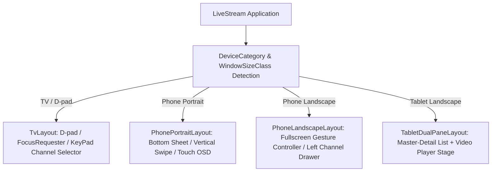

# 08 - 多端设备形态适配与交互设计规范

## 1. 概述与设计理念

`LiveStream` 针对大屏电视（Android TV / 机顶盒）、智能手机（Android Phone）以及大屏平板（Android Tablet）采用**统一业务逻辑与播放核心，分层渲染差异化交互体验**的架构策略。

杜绝简单地将手机界面强制拉伸至 TV，或将 TV 遥控焦点机械移植至触屏设备。

---

## 2. 设备形态判定矩阵

在 `:core:ui` 中封装统一的 `rememberDeviceCategory()` 与屏幕方向监听：

| 设备类型 (`DeviceCategory`) | 判定条件 | 核心交互输入 | UI 布局策略 |
|---|---|---|---|
| **TV** | `UiModeManager.currentModeType == UI_MODE_TYPE_TELEVISION` 或无触屏且大屏 | 遥控器 D-pad、数字键按键、返回键 | 全屏播放底图 + 遥控器唤起左侧抽屉 + 自动隐藏 OSD |
| **Phone** | 触屏设备且宽度类别为 `Compact` | 单手触控手势、滑动切台、单击唤起 OSD | 竖屏上下结构（上方播放+下方选台）/ 横屏全屏沉浸播放 |
| **Tablet** | 触屏设备且宽度类别为 `Expanded` | 双手触控、分栏交互 | 双栏并排（Master-Detail）：左侧分类列表 + 右侧主舞台 |

---

## 3. Android TV 交互与焦点规范

### 3.1 D-pad 遥控器按键映射
- **上下键（DPAD_UP / DPAD_DOWN）**：
  - 在全屏播放无浮层时：直接快速切换上一个 / 下一个电视频道。
  - 在频道列表/设置菜单打开时：在列表项之间平滑转移焦点。
- **左右键（DPAD_LEFT / DPAD_RIGHT）**：
  - 在全屏播放时：唤起并定位至频道分类切换，或调节音量/快进（回看流）。
  - 在分类栏时：在各分类（CCTV / 卫视 / 地方台 / 收藏）间横向切换。
- **确定键（DPAD_CENTER / KEYCODE_ENTER）**：
  - 全屏播放时唤起 OSD 频道信息面板。
  - 列表打开时确认选中当前焦点频道并关闭选台面板。
- **返回键（KEYCODE_BACK）**：
  - 优先级 1：若有浮层/抽屉处于展示状态，关闭浮层并恢复全屏播放。
  - 优先级 2：若无浮层，弹出退出应用确认提示，防止误触退出。

### 3.2 焦点记忆与可视反馈
- 使用 Compose `FocusRequester` 在菜单弹出时自动将焦点定位到**当前正在播放的频道**。
- 焦点项具备高亮呼吸边框（`BorderStroke(2.dp, CyanAccent)`）及轻微放大动效（`scale(1.05f)`），远距离观看识别率达到最佳。

### 3.3 数字键切台（Keypad Channel Selection）
- 监听 `KEYCODE_0` 到 `KEYCODE_9`，累积输入频道数字编号（如 `1` -> `CCTV-1`）。
- 防抖倒计时：输入数字后触发 1.2 秒倒计时，若无进一步按键即执行精准跳转，同时界面显示悬浮数字提示框。

---

## 4. 手机端交互与手势控制

### 4.1 竖屏模式（Portrait）
- 上半区保持 16:9 比例锁定播放器视窗。
- 下半区展示分类 Tab、频道列表及当日 EPG 节目流。
- 点击频道直接无缝切换播放，无需页面跳转。

### 4.2 横屏全屏模式（Landscape）
- **左侧滑动抽屉**：屏幕左侧边缘右滑唤出半透明频道切换列表，选台不遮挡主体画面。
- **屏幕手势调节**：
  - 左半屏垂直滑动：调节屏幕亮度。
  - 右半屏垂直滑动：调节系统媒体音量。
  - 单击任意区域：显示/隐藏顶部返回条与底部播放控制/EPG 信息条（3.5 秒无操作自动淡出）。

---

## 5. 平板端分栏布局（Dual-Pane Master-Detail）

- 充分发挥大屏平板横向空间（通常宽度 $\ge 840\text{dp}$）。
- **左侧控制面板（320dp 固定宽度）**：
  - 顶部集成搜索栏与分类切换器。
  - 中间展示当前分类下的频道列表及当前节目（EPG Now/Next）。
  - 底部快速进入“我的收藏”与系统设置。
- **右侧主舞台（自适应全屏）**：
  - 包含原生渲染核心与官方网页兼容容器。
  - 叠加当前频道的完整 EPG 时间轴抽屉，支持节目预告查看。
