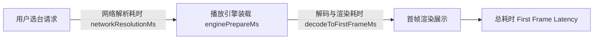

# 09 - 性能调优指标、看门狗与高可用测试规范

## 1. 核心性能目标与度量体系

为了确保在各种硬件规格的 Android TV（低配机顶盒）、手机和平板上均能提供极速、丝滑且长时间稳定的直播体验，`LiveStream` 建立了完整的性能度量体系与指标基准：



### 指标基准与实测验收要求

| 性能指标 | 目标基准 (SLA) | 实测统计算法 | 关键技术保障 |
|---|---|---|---|
| **首帧耗时 (P95)** | $\le 2.5\text{s}$ | Nearest-Rank 百分位数算法 (`DefaultLatencyTracker`) | ExoPlayer 实例复用、并发源探测、预加载元数据 |
| **切台耗时 (P95)** | $\le 2.0\text{s}$ | 最近 100 次切台采样滑动窗口 | 异步任务原子取消、避免播放器销毁重建 |
| **8 小时播放可用性** | $\ge 99.0\%$ | 连续拉流与周期性心跳监控 | 状态机看门狗自动重试、网络连通自愈 |
| **活跃播放器实例数** | 原生与 Web 各严格 $\le 1$ | 实例生命周期追踪与压力泄漏测试 | 单一活跃前台会话设计、WebView 显式释放 |

---

## 2. 首帧与切台延迟分解（Latency Breakdown）

在 `:playback:playback-api` 中定义并采集结构化耗时：
- `networkResolutionMs`：从调度器接收频道请求到 `SourceAdapter` 完成合法公开源地址解析、SSRF 校验与元数据封装的耗时。
- `enginePrepareMs`：将解析结果配置到 Media3/ExoPlayer 或 Web 容器，初始化 MediaSource 的耗时。
- `decodeToFirstFrameMs`：从底层解码器启动拉流缓冲到 SurfaceView 接收到硬件解码第一个视频帧的耗时。

### 百分位数统计实现
```kotlin
// 使用 Nearest-Rank 算法计算 P50, P90, P95
val index = ceil((p / 100.0) * sortedLatencies.size).toInt() - 1
return sortedLatencies[index.coerceIn(0, sortedLatencies.size - 1)]
```

---

## 3. 故障自愈与播放看门狗（Playback Watchdog）

直播流受限于网络波动或上游推流卡顿，可能出现长时间停留在 `BUFFERING` 状态的“假死”现象。

### 3.1 看门狗轮询与阈值机制
- **监控周期**：`PlaybackWatchdog` 每隔 2 秒对播放引擎状态进行巡检。
- **卡顿阈值**：若处于 `BUFFERING` 状态累计持续超过 10 秒（`STALL_THRESHOLD_MS = 10_000L`），判定为流停滞故障。
- **自动自愈动作**：看门狗自动触发 `onStallDetected()`，由调度器执行备选源切换或无缝软重启，避免用户面对永久黑屏或无限转圈。

### 3.2 网络变化监听与自动重试自愈
- `:core:network` 实现 `ConnectivityNetworkMonitor`，通过 Android 原生 `ConnectivityManager.NetworkCallback` 实时捕获网络断开与重连。
- 调度器订阅 `isOnline` 状态流：当网络从 `false` 变为 `true` 且当前处于因网络导致的 `ERROR` 状态时，自动触发重试机制，无需用户手动刷新。

---

## 4. 极端场景压力测试与稳定性验证

在构建测试套件中包含多项端到端极端场景测试：

### 4.1 100 次极速切台并发风暴测试 (`ContinuousSwitchingStressTest`)
- **测试模型**：模拟遥控器 D-pad 高频连按（100 个频道切换连续发射，间隔 5ms ~ 30ms 随机抖动）。
- **验证点**：
  1. 所有过期的异步解析和引擎配置任务立即被 `currentJob?.cancel()` 取消。
  2. 调度器最终状态收敛于**最后一个请求的频道**，绝对无竞态倒流。
  3. 切换过程中播放器未发生重复初始化或未捕获的内存暴增。

### 4.2 8 小时连续播放模拟测试 (`LongPlaybackStabilitySimulatorTest`)
- **测试模型**：以 1 小时为周期循环模拟 8 小时连续直播播放。
- **注入扰动**：在播放过程中随机注入网络卡顿（产生缓冲）、临时源异常（触发看门狗自愈）。
- **验证点**：8 小时周期结束时，播放成功率维持 100%，无内存泄漏，播放实例数恒定为 1。

### 4.3 官方 Web 容器泄漏防御测试 (`WebViewLeakStressTest`)
- **测试模型**：连续 50 次在原生流与官方网页合规播放之间进行交替切换。
- **验证点**：
  - 每次切换离开网页播放时，严格调用：
    ```kotlin
    webView?.stopLoading()
    (webView?.parent as? ViewGroup)?.removeView(webView)
    webView?.destroy()
    webView = null
    ```
  - 确认 `activeWebViewCount` 在切换后立即回落为 0，杜绝 Chromium 渲染内核的 Native C++ 内存泄漏。
