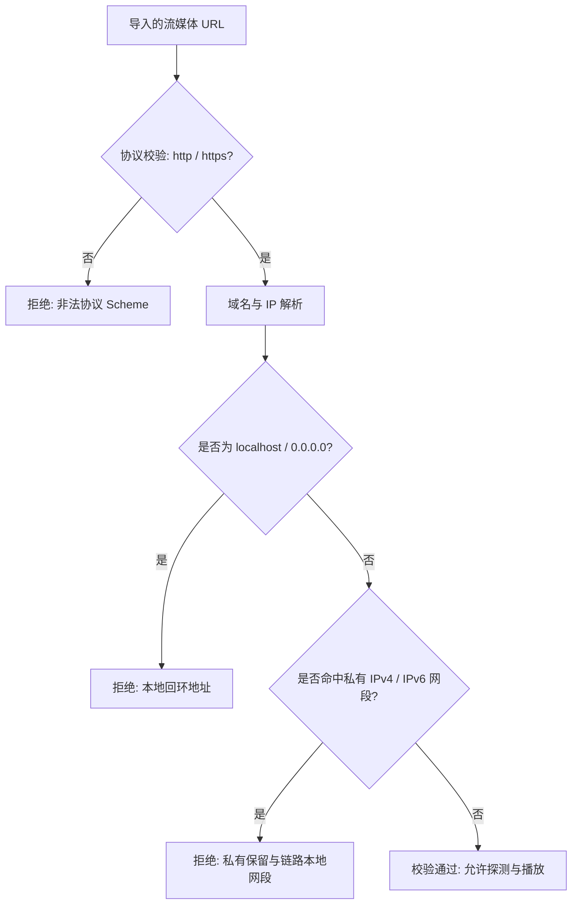

# 10 - 发布规范与合规安全防护体系

## 1. 合规接入与数据安全基石

`LiveStream` 秉承严谨的合法合规接入原则：
1. **公开合法资源优先**：仅接入官方公开且明确允许第三方接入的合法流媒体资源，或由用户自主导入其合法持有的源。
2. **严禁逆向与绕过**：杜绝通过反编译、逆向工程、破解授权、伪造鉴权 Cookie/Token 或绕过 DRM/地域限制获取直播流。
3. **真实性原则**：绝不虚构直播流、节目单接口或播放成功状态。

---

## 2. SSRF（服务端/客户端请求伪造）多维防御

在用户自定义 M3U 直播源或外部 EPG 订阅导入时，恶意构造的 URL 可能会试图探测局域网内部服务（如内网路由器后台 `192.168.1.1`、云服务器元数据 `169.254.169.254` 等）。

`SsrfUrlValidator` 在 `:source:source-custom` 中执行强制层级防御：



### 拦截网段范围
- **IPv4 私有地址**：
  - `10.0.0.0/8`
  - `172.16.0.0/12`
  - `192.168.0.0/16`
  - `127.0.0.0/8`（回环）
  - `169.254.0.0/16`（链路本地 / 云服务 Metadata API）
- **IPv6 保留地址**：
  - `::1`（回环）
  - `fe80::/10`（链路本地）
  - `fc00::/7`（唯一本地地址 ULA）

---

## 3. WebView 独立合规容器安全加固

官方网页备用播放容器（`:playback:playback-web`）仅在流媒体确实要求网页展示且使用条款允许时启用，具备沙箱化隔离：

1. **禁用本地文件系统访问**：
   ```kotlin
   settings.apply {
       allowFileAccess = false
       allowContentAccess = false
       allowFileAccessFromFileURLs = false
       allowUniversalAccessFromFileURLs = false
   }
   ```
2. **隔离渲染崩溃**：
   实现 `WebViewClient.onRenderProcessGone` 并返回 `true`，防止 Web 渲染进程崩溃（如显存超限或网页 OOM）直接拖垮整个应用宿主进程，触发状态机向用户展示友好的降级提示。
3. **加载超时阻断**：
   针对网页加载设定 15 秒超时守护，避免异常官方页面无响应造成界面挂起。
4. **内存闭环释放**：
   在离开播放界面或切换至原生流时，显式执行 `stopLoading()`、从父容器移除 `removeView()` 并调用 `destroy()`。

---

## 4. ProGuard / R8 混淆与发布保护

在 `app/proguard-rules.pro` 中配置精细化保留规则：
- 保留 Kotlinx Serialization 注解及内部生成序列化器。
- 保留 Room 实体类、DAO 接口及数据库基类。
- 保留 AndroidX Media3 / ExoPlayer 核心组件与硬件编解码器反射查找（`mediacodec`）。
- 保留 Dagger/Hilt 依赖注入类。
- 混淆并剥离无用代码与资源（启用 `getDefaultProguardFile("proguard-android-optimize.txt")`）。

---

## 5. 发布打包与制品构建

应用通过 Gradle Kotlin DSL 规范化配置产物：
- **命名空间**：`com.livestream.app`
- **最小 SDK**：`minSdk = 23`（支持 Android 6.0+ 全系列 TV 电视、电视盒子、手机与平板）
- **目标 SDK**：`targetSdk = 34`（Android 14 现代系统契约）
- **编译 SDK**：`compileSdk = 34`
- **JVM 工具链**：Java 17 (`JavaVersion.VERSION_17`)
- **构建产物**：
  - Debug APK: `app/build/outputs/apk/debug/app-debug.apk`
  - Release APK: `app/build/outputs/apk/release/app-release.apk`
